# 🎬 Movie Genre Classifier

**CodSoft Machine Learning Internship – Task 1: Movie Genre Classification**

A machine-learning system that predicts a movie's genre (27 classes) from its plot summary. It uses
TF-IDF and Word2Vec text features with Naive Bayes, Logistic Regression and Linear SVM classifiers,
and ships with a Streamlit web app, a command-line tool and an automated test suite.

Repository: **https://github.com/shivrajsinghtech/CODSOFT_TASK1**

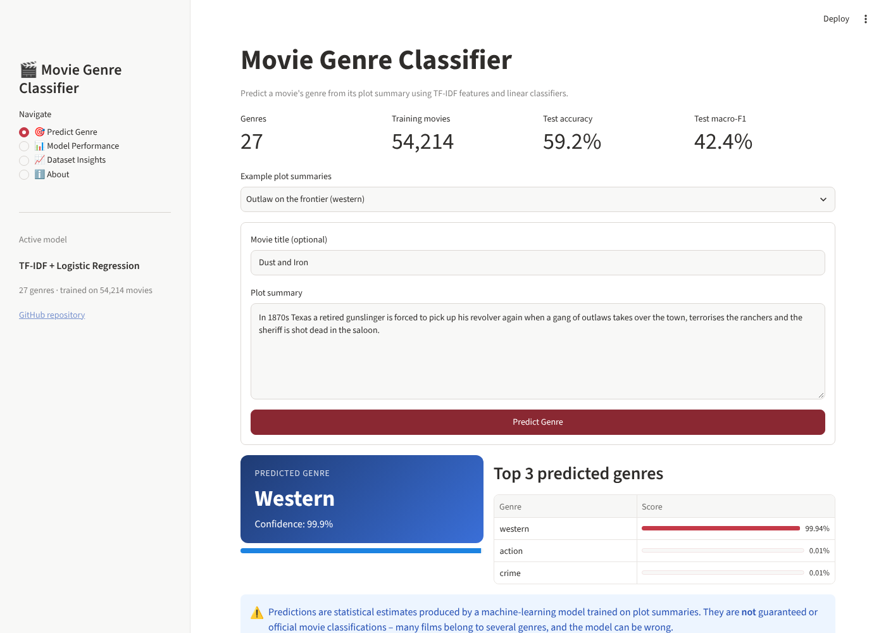

---

## Contents
1. [Problem statement](#problem-statement)
2. [Dataset](#dataset)
3. [Technologies](#technologies)
4. [Data preprocessing & EDA](#data-preprocessing--eda)
5. [NLP methodology](#nlp-methodology)
6. [Models & tuning](#models--tuning)
7. [Results](#results)
8. [Installation](#installation)
9. [Usage](#usage)
10. [Project structure](#project-structure)
11. [Testing](#testing)
12. [Screenshots](#screenshots)

---

## Problem statement

Given the plot summary of a movie (and optionally its title), predict its genre. This is a
**multi-class text classification** problem with 27 heavily imbalanced classes. The largest genre
(drama, 13,613 movies) is about 103 times the size of the smallest (war, 132 movies).

## Dataset

**Genre Classification Dataset (IMDb).** According to `description.txt`, the source is
`ftp://ftp.fu-berlin.de/pub/misc/movies/database/`, the IMDb plain-text data dumps.

| File | Records | Format |
|---|---|---|
| `train_data.txt` | 54,214 | `ID ::: TITLE ::: GENRE ::: DESCRIPTION` |
| `test_data.txt` | 54,200 | `ID ::: TITLE ::: DESCRIPTION` |
| `test_data_solution.txt` | 54,200 | `ID ::: TITLE ::: GENRE ::: DESCRIPTION` |
| `description.txt` | – | format and source description |

Data quality findings (from `reports/eda_summary.json`):
- Every line parsed into the expected number of fields. There were **0 malformed, 0 blank and 0 empty-description** records, and nothing was dropped.
- There were **0 duplicate IDs** and **0 fully duplicated rows**. 128 descriptions repeat under *different* titles (15 of them with conflicting genres); they were kept as genuine records.
- `test_data.txt` and `test_data_solution.txt` match row for row (same IDs and descriptions).
- Plot length: median 79 words, mean 102, 95th percentile 242, maximum 1,829.

The raw files (about 105 MB) are not committed. See [`data/README.md`](data/README.md) for where to put them.

## Technologies

Python 3.13 · pandas · NumPy · scikit-learn · gensim (Word2Vec) · Matplotlib / Seaborn ·
Streamlit · joblib · pytest · Playwright (screenshots)

## Data preprocessing & EDA

**Parsing** (`src/data_loader.py`): each line is split on `:::` at most *n − 1* times, so colons,
quotes and other punctuation inside descriptions are preserved. Fields are stripped of whitespace
and genres are lower-cased. Malformed lines are counted and reported instead of being silently dropped.

**Cleaning** (`src/preprocessing.py`, stored inside the model pipeline):
- The title is cleaned (year markers such as `(2009)` and `(????)` removed) and placed before the plot.
- Text is lower-cased and accent-folded (é → e). URLs are removed and punctuation becomes spaces.
- **Numbers are kept**, because years and ages carry signal for history and documentary plots.
- There is no stemming. English stop words are removed by the vectoriser.

**EDA figures** (`reports/figures/`):

| Genre distribution | Description length by genre |
|---|---|
| 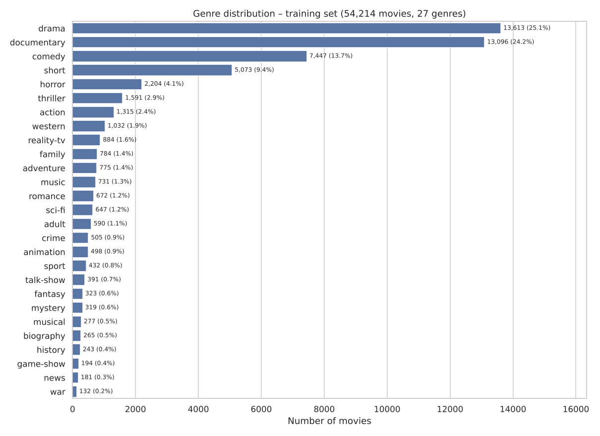 | 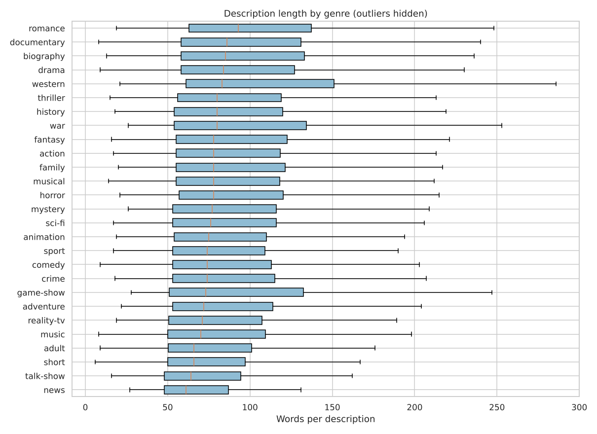 |

| Most distinctive words per genre (class TF-IDF) | Most common words, largest genres |
|---|---|
| 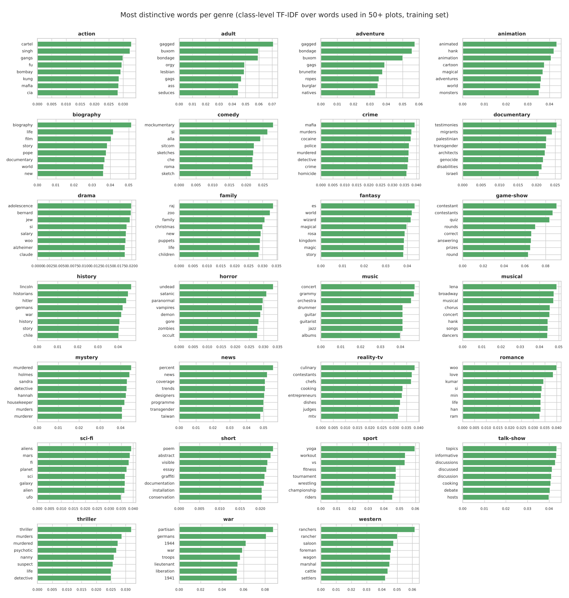 | 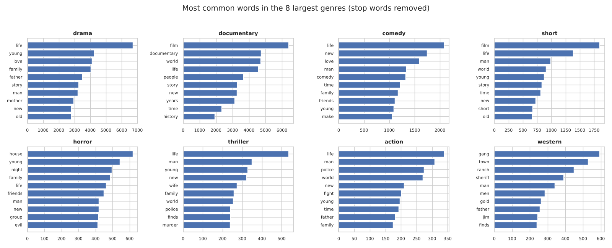 |

The distinctive words are what you would expect: *ranchers, saloon, cattle* for western;
*aliens, mars, galaxy* for sci-fi; *contestant, quiz* for game-show; *undead, satanic* for horror.

## NLP methodology

| Technique | Details |
|---|---|
| **TF-IDF** | unigrams + bigrams, `sublinear_tf=True`, `min_df=2`, `max_df=0.9`, English stop words removed, top 150,000 features |
| **Word embeddings** | Word2Vec (CBOW, 100 dimensions, window 5, 10 epochs), trained on the training texts only. Each document is the mean of its word vectors, then standardised. |

## Models & tuning

All models are complete `sklearn.pipeline.Pipeline`s (vectoriser + classifier), so the same
preprocessing runs at training and prediction time.

| # | Model | Grid searched |
|---|---|---|
| 1 | TF-IDF + **Multinomial Naive Bayes** | `alpha` ∈ {0.01, 0.03, 0.1, 0.3, 1} × `fit_prior` ∈ {True, False} |
| 2 | TF-IDF + **Logistic Regression** | `C` ∈ {1, 5, 20} × `class_weight` ∈ {None, balanced} |
| 3 | TF-IDF + **Linear SVM** (sigmoid-calibrated for probability scores) | `C` ∈ {0.1, 0.3, 1} × `class_weight` ∈ {None, balanced} |
| + | Word2Vec + Logistic Regression *(supplementary)* | `class_weight` ∈ {None, balanced} |

**Leakage-free protocol**
1. Make a stratified 80/20 split of `train_data.txt` (43,371 train / 10,843 validation).
2. Fit the vectoriser on the 80 % part only, and score every grid point on the validation part.
3. Select by **validation macro-F1**, so rare genres count as much as frequent ones. Class weighting
   (`balanced`, or uniform NB priors) is treated as a tuning option to handle imbalance.
4. Refit the selected configuration on all 54,214 training movies and save it with `joblib`.
5. Evaluate **once** on `test_data_solution.txt`, after selection.

## Results

**Selected model: TF-IDF + Logistic Regression (C = 5, class_weight = balanced)**

### Official held-out test set (54,200 movies)

| Model | Accuracy | Macro precision | Macro recall | Macro F1 | Weighted F1 |
|---|---|---|---|---|---|
| **TF-IDF + Logistic Regression** ✅ | 0.5916 | 0.4168 | **0.4431** | **0.4236** | 0.5931 |
| TF-IDF + Linear SVM | **0.6219** | **0.5074** | 0.3745 | 0.4126 | **0.5975** |
| TF-IDF + Multinomial Naive Bayes | 0.5704 | 0.3934 | 0.3786 | 0.3769 | 0.5571 |
| Word2Vec + Logistic Regression | 0.5629 | 0.3975 | 0.2806 | 0.3102 | 0.5299 |

Selected model: **top-3 accuracy 84.9 %**. Validation scores (used for selection) were within 0.01 of the
test scores. See [`reports/evaluation_report.md`](reports/evaluation_report.md) for the full analysis.

**Why not the SVM, which has the highest accuracy?** The unweighted SVM wins on accuracy by favouring the
large genres. Balanced Logistic Regression gives up about 3 accuracy points but raises macro recall
from 0.37 to 0.44, so it recognises rare genres such as war, sport, music and sci-fi much more often.
The selection criterion (macro-F1) was fixed before the test set was seen.

| Model comparison (test) | Confusion matrix (test, row-normalised) |
|---|---|
| 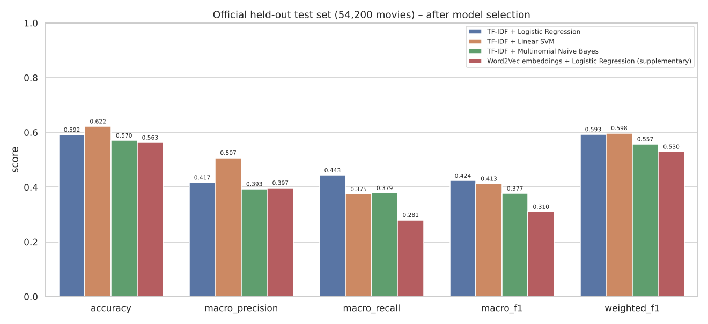 | 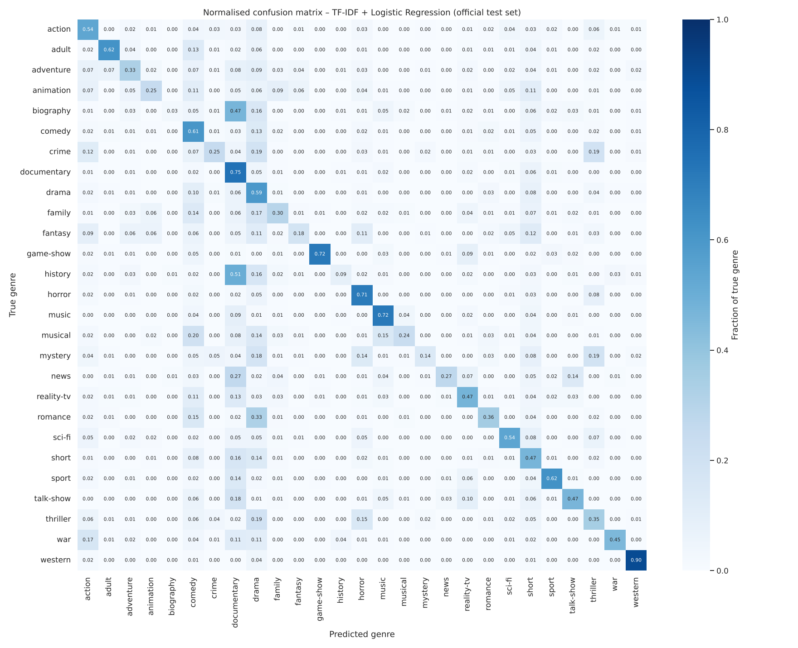 |

**Per genre:** best on western (F1 0.86), documentary (0.76), game-show (0.73) and horror (0.65).
Weakest on biography (0.04) and history (0.11), which are usually predicted as documentary, and on
mystery and crime, which get confused with thriller and drama. Full table:
[`reports/per_genre_metrics_test.csv`](reports/per_genre_metrics_test.csv).

## Installation

```bash
git clone https://github.com/shivrajsinghtech/CODSOFT_TASK1.git
```

```bash
cd CODSOFT_TASK1
```

```bash
python -m venv .venv && source .venv/bin/activate   # Windows: .venv\Scripts\activate
```

```bash
pip install -r requirements.txt
```

The trained pipeline (`models/genre_classifier.joblib`, 17 MB) is included, so the app and CLI work
right away. To retrain, extract the dataset into `data/raw/Genre Classification Dataset/`.

> 🔒 **Security note:** `.joblib` model files are pickles, and loading a pickle can run code. Only load
> model files you trained yourself or took from this repository. See [SECURITY.md](SECURITY.md).

## Usage

**Web app**

```bash
streamlit run app.py
```

Open http://localhost:8501. Enter a title and plot (or pick an example), then press **Predict Genre**.

**Command line**

```bash
python predict.py --title "Red Horizon" --plot "In 2140 the first colony on Mars loses contact with Earth..."
```

```bash
python predict.py --input "data/raw/Genre Classification Dataset/test_data.txt" --output predictions.csv
```

**Retrain everything** (EDA, tuning, refit, final evaluation; about 10 minutes on 4 cores)

```bash
python train.py
```

**Notebook:** `notebooks/movie_genre_classification.ipynb` walks through the EDA and results.

> ⚠️ Predictions are statistical **model estimates**, not guaranteed or official movie classifications.

## Project structure

```
CODSOFT_TASK1/
├── app.py                  # Streamlit application
├── train.py                # training / evaluation entry point
├── predict.py              # command-line predictions
├── requirements.txt        # pinned dependency versions
├── LICENSE                 # MIT
├── SECURITY.md
├── pytest.ini
├── data/README.md          # where to put the raw dataset (not committed)
├── models/
│   ├── genre_classifier.joblib          # best complete pipeline
│   └── genre_classifier_metadata.json
├── notebooks/movie_genre_classification.ipynb
├── reports/
│   ├── evaluation_report.md
│   ├── metrics.json, eda_summary.json
│   ├── validation_model_comparison.csv, validation_tuning_results.csv
│   ├── test_model_comparison.csv, per_genre_metrics_test.csv, confusion_matrix_test.csv
│   ├── (test_predictions.csv)           # generated by train.py, not committed
│   ├── figures/                         # EDA and evaluation charts
│   └── screenshots/                     # app screenshots
├── src/
│   ├── config.py           # paths and constants
│   ├── data_loader.py      # ::: parsing with malformed-line reporting
│   ├── preprocessing.py    # text cleaning
│   ├── label_encoding.py   # genre normalisation and encoding
│   ├── embeddings.py       # Word2Vec sklearn transformer
│   ├── models.py           # pipelines and hyper-parameter grids
│   ├── training.py         # tuning, selection, refit, final evaluation
│   ├── evaluation.py       # metrics and plots
│   ├── eda.py              # exploratory analysis
│   └── predictor.py        # save/load, validation, top-k prediction
└── tests/                  # pytest suite (64 tests)
```

## Testing

```bash
python -m pytest -v
```

There are 64 tests, and all pass. They cover dataset parsing and loading (including the real record
counts), text preprocessing, label encoding, training of every model, end-to-end training on a
fixture dataset, prediction, top-3 output, model saving and loading, empty or invalid input, the
CLI, and Streamlit start-up and interaction (via `streamlit.testing.AppTest`). FutureWarnings are
treated as errors.

## Screenshots

| Home | Prediction |
|---|---|
| 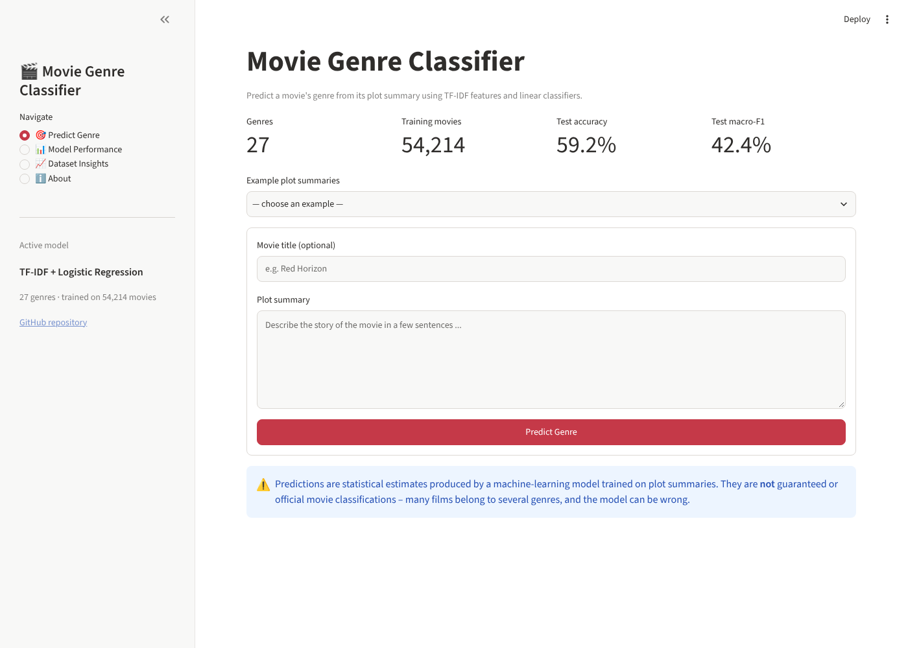 |  |

| Empty-input validation | Model performance |
|---|---|
| 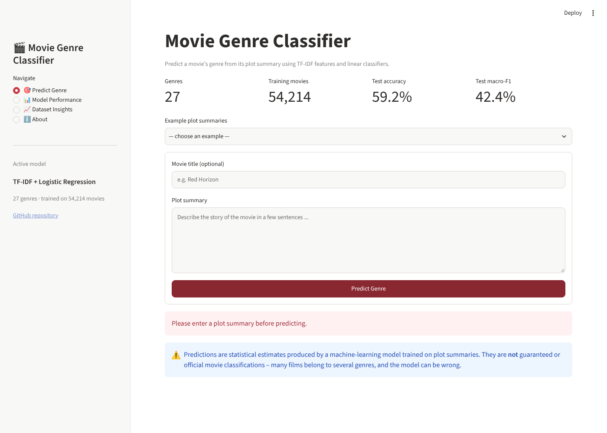 | 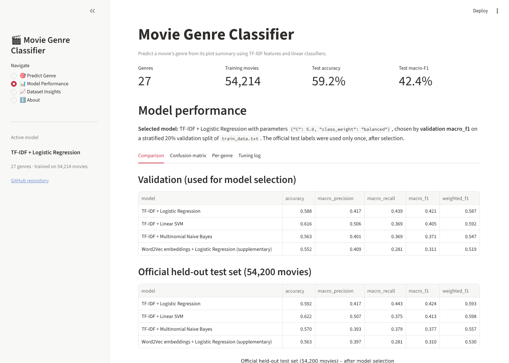 |

| Confusion matrix | Dataset insights |
|---|---|
| 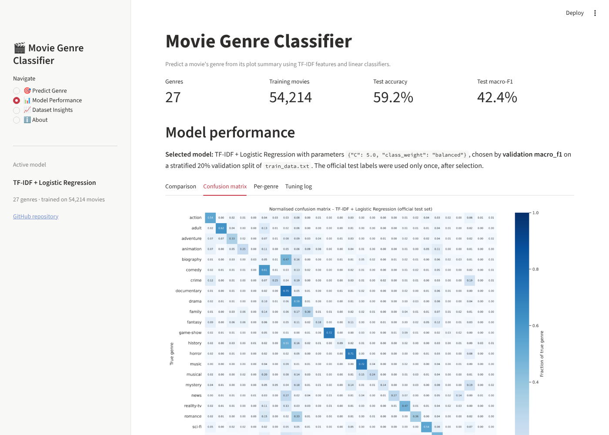 | 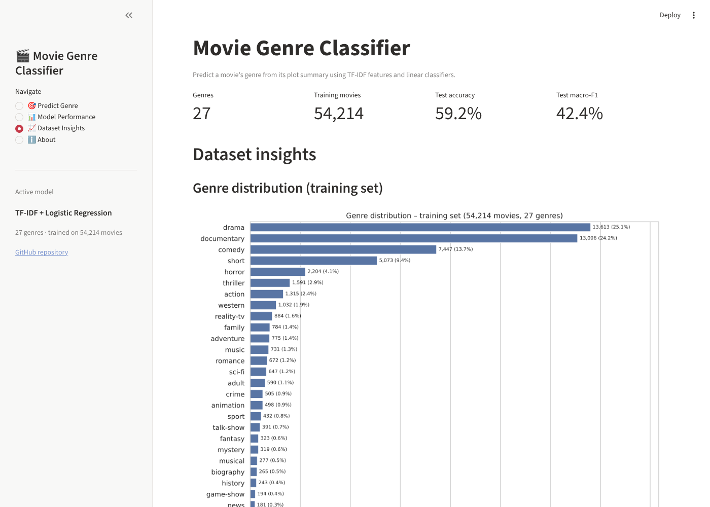 |

---

*Built for the CodSoft Machine Learning Internship.* · Licensed under the [MIT License](LICENSE).
