# 📉 Customer Churn Prediction

**CodSoft Machine Learning Internship — Task 3**

This project predicts whether a bank customer will leave (churn), using their demographics and account behaviour. I compared Logistic Regression, Random Forest and Gradient Boosting inside leakage-free scikit-learn pipelines, tuned each with stratified cross-validation, and deployed the best model in a Streamlit dashboard.

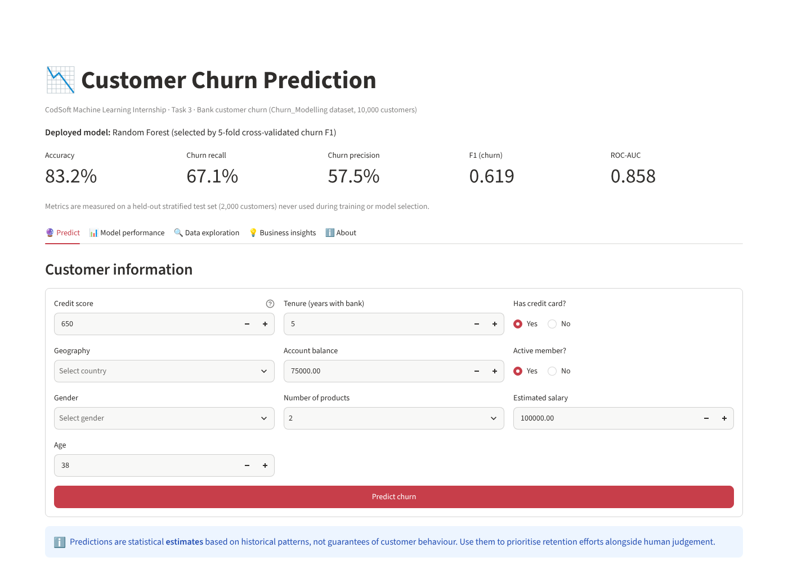

---

## 🎯 Objective

Build a model that estimates a customer's **probability of leaving**, so a business can target retention efforts at the customers most at risk. Because only ~20% of customers churn, the project focuses on **churn recall, precision and F1**, not just accuracy.

## 📂 Dataset

| Item | Value |
|---|---|
| File | `data/Churn_Modelling.csv` |
| Source | "Churn Modelling" bank-customer dataset, publicly available on Kaggle |
| Rows / columns | 10,000 customers × 14 columns |
| Target | `Exited` (1 = customer left, 0 = stayed) |
| Missing values / duplicates | 0 / 0 |
| Class balance | 7,963 stayed (79.6%) · 2,037 churned (20.4%) |

> **Data note:** This is a publicly available dataset (the "Churn Modelling" dataset on Kaggle), included here unmodified for reproducibility. It contains customer identifier fields (`RowNumber`, `CustomerId`, `Surname`). These fields are removed during preprocessing and are never used for model training or prediction.

| Column | Type | Description |
|---|---|---|
| RowNumber, CustomerId, Surname | identifier | **Dropped**: they carry no predictive meaning |
| CreditScore | numeric | Credit score (350–850) |
| Geography | categorical | France / Germany / Spain |
| Gender | categorical | Male / Female |
| Age | numeric | 18–92 |
| Tenure | numeric | Years as a customer (0–10) |
| Balance | numeric | Account balance |
| NumOfProducts | numeric | Bank products held (1–4) |
| HasCrCard | binary | Owns a credit card |
| IsActiveMember | binary | Active member |
| EstimatedSalary | numeric | Estimated salary |

## 🛠️ Technologies

Python 3.13 · pandas · NumPy · scikit-learn · matplotlib · seaborn · joblib · Streamlit · pytest · Jupyter

## 🗂️ Project structure

```
CODSOFT_TASK3/
├── app.py                     # Streamlit dashboard
├── train.py                   # End-to-end training: EDA → tuning → evaluation → save
├── requirements.txt
├── data/Churn_Modelling.csv   # Dataset (from the provided ZIP, unmodified)
├── notebooks/churn_analysis.ipynb  # Executed EDA & results walkthrough
├── src/
│   ├── config.py              # Paths, column groups, random state
│   ├── data.py                # Loading, cleaning, data-quality report
│   ├── preprocessing.py       # ColumnTransformer (impute, scale, one-hot)
│   ├── models.py              # Model specs, grids, GridSearchCV tuning
│   ├── evaluate.py            # Metrics and permutation importance
│   ├── eda.py                 # EDA charts
│   ├── reporting.py           # Evaluation charts and markdown reports
│   └── predict.py             # Input validation, save/load, single prediction
├── models/churn_pipeline.joblib    # Trained pipeline (preprocessing + model)
├── reports/
│   ├── eda_report.md
│   ├── model_comparison.md
│   ├── metrics.json
│   ├── figures/               # 15 EDA and evaluation charts
│   └── screenshots/           # App screenshots
└── tests/                     # 44 pytest tests
```

## 🧹 Data preprocessing

1. Load and check the schema (`src/data.py`). The real dataset is used as-is; no values are made up or randomly replaced.
2. Drop the identifiers `RowNumber`, `CustomerId` and `Surname`.
3. Check for missing values (0) and duplicate rows (0).
4. **Stratified 80/20 train/test split** with `random_state=42` (train 8,000 / test 2,000, both 20.4% churn).
5. Transform the features with a `ColumnTransformer` inside a `Pipeline`:
   - Numeric (`CreditScore, Age, Tenure, Balance, NumOfProducts, EstimatedSalary`): median imputation + `StandardScaler`
   - Binary (`HasCrCard, IsActiveMember`): passed through (most-frequent imputation)
   - Categorical (`Geography, Gender`): `OneHotEncoder(handle_unknown="ignore")`
6. **No data leakage:** all preprocessing is fitted inside each cross-validation fold on the training data only. The test set is used exactly once, for the final evaluation.

The imputers never run on this dataset, which has no missing values. They are there so the saved pipeline can still cope with an incomplete record at prediction time.

## 🔍 Exploratory data analysis

The full write-up is in [`reports/eda_report.md`](reports/eda_report.md) and the charts are in [`reports/figures/`](reports/figures/).

| Finding | Evidence |
|---|---|
| **Age is the strongest driver** | Churners average 44.8 years vs 37.4; churn is 7.5% at 18–30 but **56.2% at 51–60** |
| **Number of products is strongly non-linear** | 1 product 27.7% · **2 products 7.6%** · 3 products 82.7% · 4 products 100% |
| **Inactive members churn ~2× more** | 26.9% vs 14.3% |
| **Germany is a hotspot** | Germany 32.4% vs France 16.2% and Spain 16.7% |
| **Women churn more** | Female 25.1% vs male 16.5% |
| Customers with a balance churn more | Balance > 0: 24.1% vs zero balance 13.8% |
| Weak or no effect | Credit score, tenure, salary, credit-card ownership |

| | | |
|---|---|---|
| 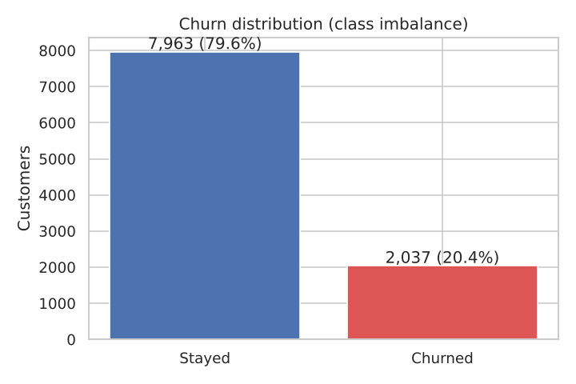 | 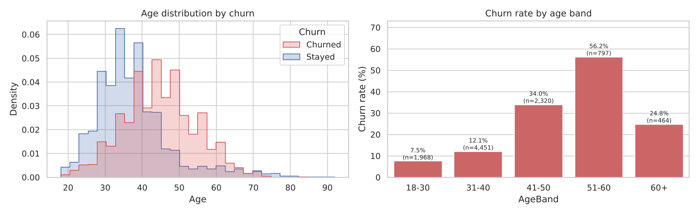 | 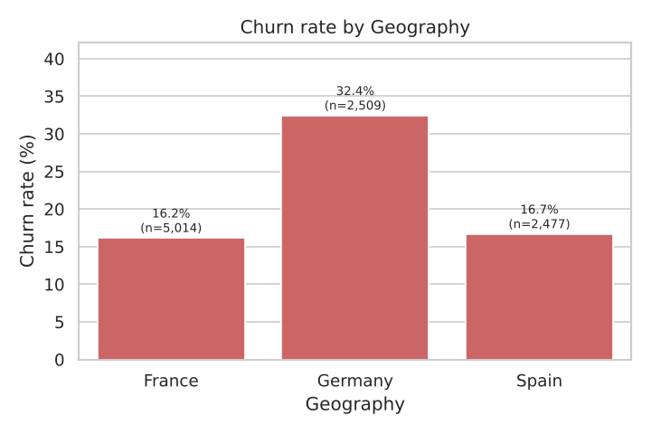 |
| 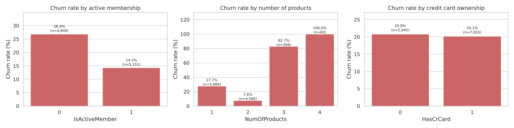 | 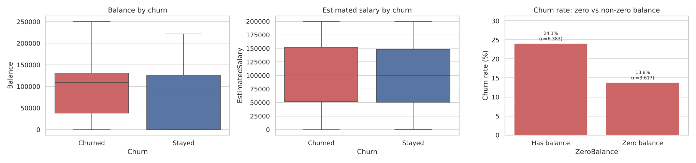 | 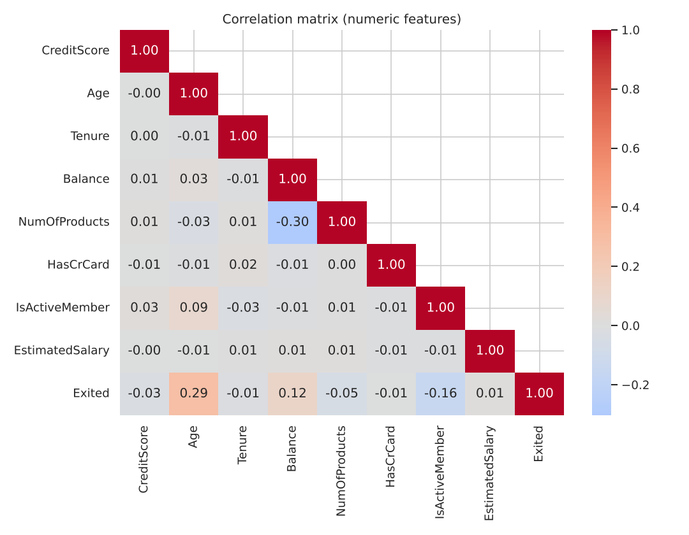 |

## 🤖 Machine learning models

Each model was tuned with `GridSearchCV` using **5-fold stratified cross-validation** on the training set. Selection was based on the **F1-score of the churn class**, because both kinds of error cost money: a missed churner is a lost customer, and a false alarm wastes retention budget.

To handle the 80/20 class imbalance, Logistic Regression and Random Forest use `class_weight="balanced"`, and Gradient Boosting uses balanced `sample_weight`.

| Model | Grid searched | Best parameters |
|---|---|---|
| Logistic Regression | `C ∈ {0.01, 0.1, 1, 10}` | C = 0.01 |
| Random Forest | `max_depth ∈ {8, 12, None}`, `min_samples_leaf ∈ {1, 5, 10}`, 300 trees | max_depth = 12, min_samples_leaf = 1 |
| Gradient Boosting | `n_estimators ∈ {150, 300}`, `learning_rate ∈ {0.05, 0.1}`, `max_depth ∈ {3, 4}` | 300, 0.1, 3 |

## 📊 Results (actual output of `python train.py`)

**Cross-validation on the training set (mean of 5 folds)**

| Model | CV F1 | CV Recall | CV ROC-AUC |
|---|---|---|---|
| Logistic Regression | 0.4932 | 0.6859 | 0.7673 |
| **Random Forest** | **0.6117** | 0.6534 | 0.8537 |
| Gradient Boosting | 0.6077 | **0.7190** | **0.8603** |

**Held-out test set (2,000 customers, 407 churners)**

| Model | Accuracy | Precision | Recall | F1 | ROC-AUC | TN | FP | FN | TP |
|---|---|---|---|---|---|---|---|---|---|
| Logistic Regression | 0.7180 | 0.3926 | 0.7052 | 0.5044 | 0.7771 | 1149 | 444 | 120 | 287 |
| **Random Forest** ✅ | **0.8320** | **0.5747** | 0.6708 | **0.6190** | 0.8575 | 1391 | 202 | 134 | 273 |
| Gradient Boosting | 0.8085 | 0.5207 | **0.7420** | 0.6120 | **0.8588** | 1315 | 278 | 105 | 302 |

**Selected model: Random Forest.** It had the highest cross-validated churn F1. Comparing honestly:

- **Random Forest and Gradient Boosting are close.** Their CV F1 scores differ by only 0.004, which is within one standard deviation.
- **Gradient Boosting catches more churners** (recall 0.742 vs 0.671, 29 more on the test set) and has a slightly higher ROC-AUC. The trade-off is 76 more false alarms.
  - If missing a churner costs much more than a retention offer, Gradient Boosting is a reasonable alternative.
- **Logistic Regression is clearly weaker** (F1 0.50). The churn patterns are non-linear, for example the U-shaped effect of the number of products, and a linear model cannot capture them.

Permutation importance for the selected model ranks **Age**, **NumOfProducts**, **Balance**, **IsActiveMember** and **Geography** as the top drivers, which matches the EDA.

| | |
|---|---|
| 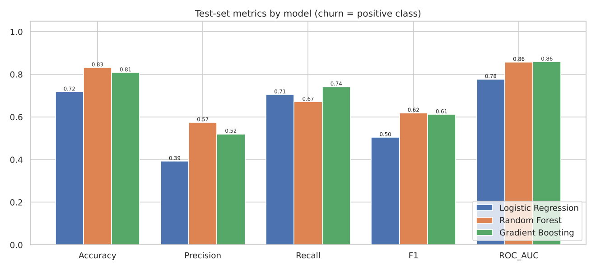 | 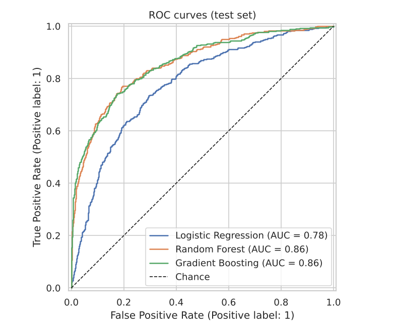 |
| 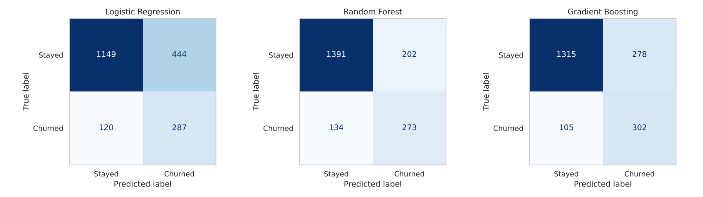 | 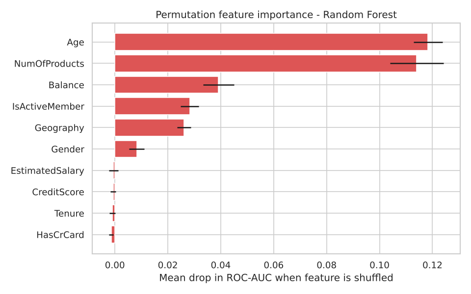 |

The full report is in [`reports/model_comparison.md`](reports/model_comparison.md) and the raw numbers are in [`reports/metrics.json`](reports/metrics.json).

## 🚀 Installation

```bash
git clone https://github.com/shivrajsinghtech/CODSOFT_TASK3.git
cd CODSOFT_TASK3
python -m venv .venv
# Windows: .venv\Scripts\activate    macOS/Linux: source .venv/bin/activate
pip install -r requirements.txt
```

## ▶️ How to run

The trained model is already included, so you can launch the app straight away:

```bash
streamlit run app.py
```

Then open http://localhost:8501.

Retrain everything (EDA charts, tuning, evaluation, reports and model file). This takes about 1 minute:

```bash
python train.py
```

Run the tests:

```bash
python -m pytest -v
```

## 🖥️ Streamlit application

- **Predict:** a customer form covering all 10 features, with validation of required fields and allowed ranges.
  - Shows *likely to churn / stay*, the churn probability, the prediction confidence, a risk band, and the risk factors found in the historical data.
- **Model performance:** the comparison table, confusion matrices, ROC curves, feature importance and the classification report.
- **Data exploration:** all EDA charts.
- **Business insights:** key findings and recommended retention actions.

> ⚠️ Predictions are statistical **estimates** based on historical patterns, not guarantees of how a customer will behave.

| Prediction | Model performance |
|---|---|
| 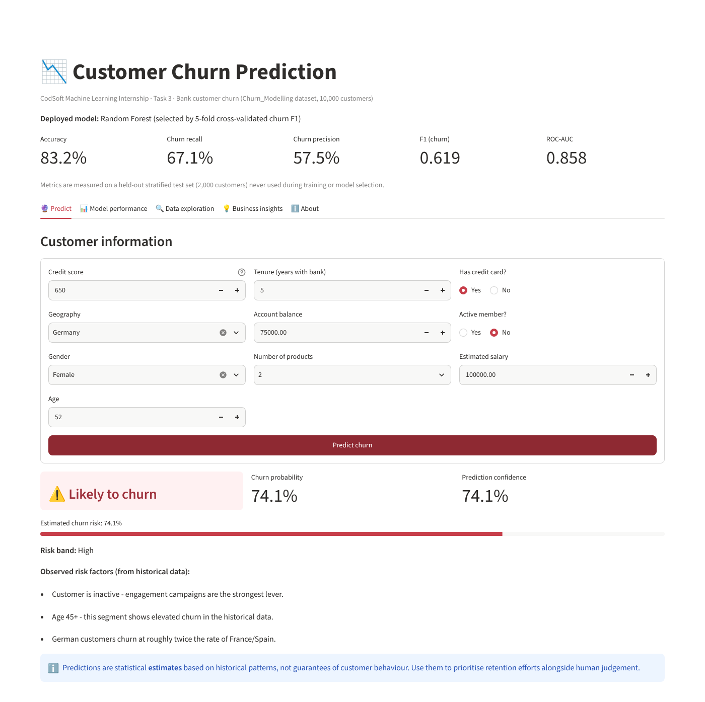 | 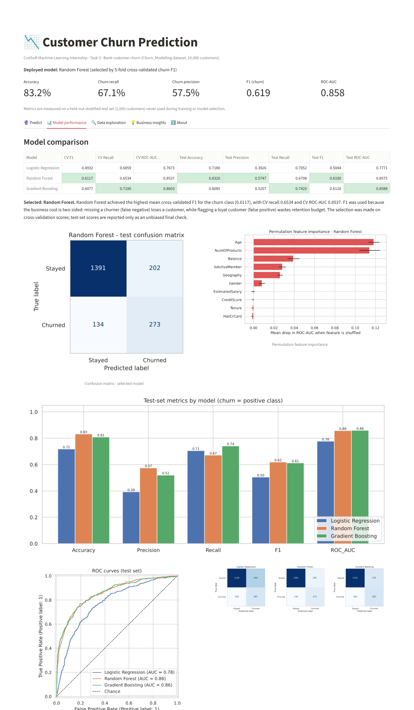 |
| **Data exploration** | **Business insights** |
| 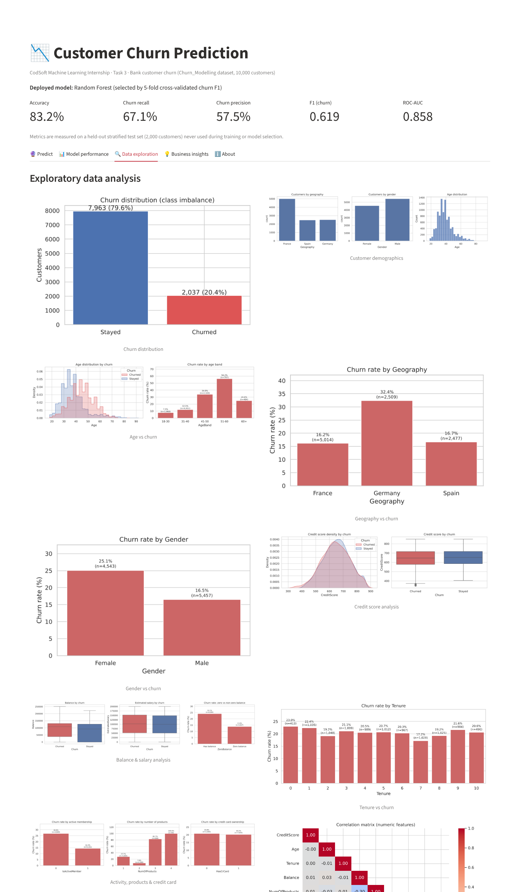 | 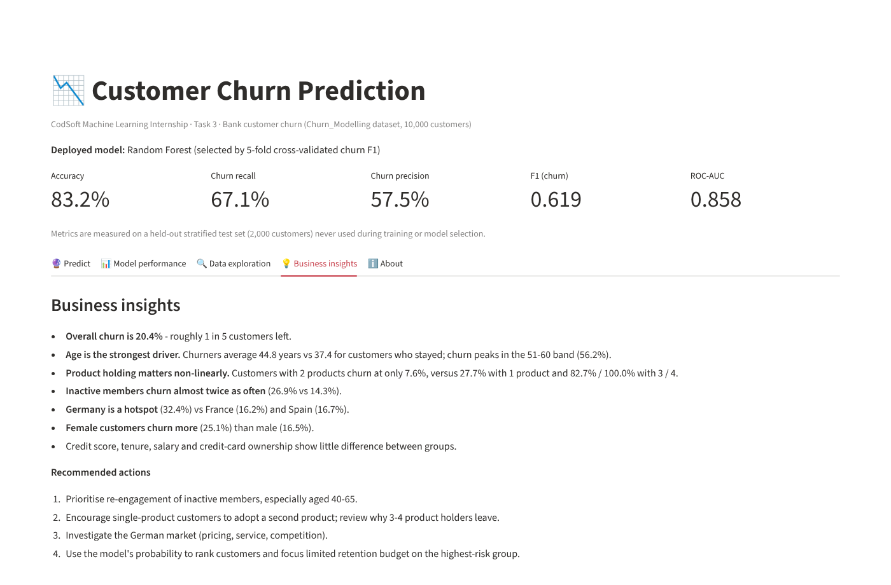 |

## ✅ Testing

There are **44 pytest tests** covering:

- dataset loading and schema errors
- cleaning, duplicate removal, missing-value checks
- encoding and scaling
- handling of unknown categories and missing values
- training and prediction for all three algorithms
- saving and reloading the model (serialization round-trip)
- the saved production model
- valid, invalid and missing customer inputs
- Streamlit startup, a full prediction, and missing-input error messages, using `streamlit.testing`

## ⚠️ Limitations

- The data is a single historical snapshot from one bank in three countries. Patterns may not transfer to other businesses or time periods.
- The decision threshold is the default 0.5. A business could lower it to catch more churners, at the cost of more false alarms.

## 🔗 Repository

https://github.com/shivrajsinghtech/CODSOFT_TASK3

---
*Author: Shivraj Singh — B.Tech student, CodSoft Machine Learning Intern*
