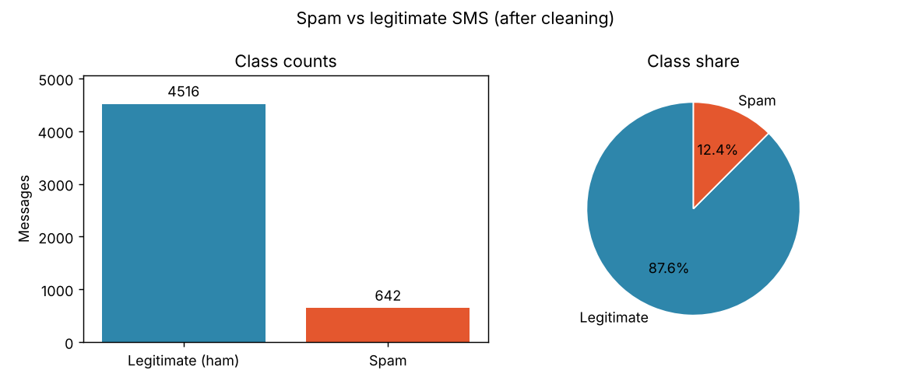
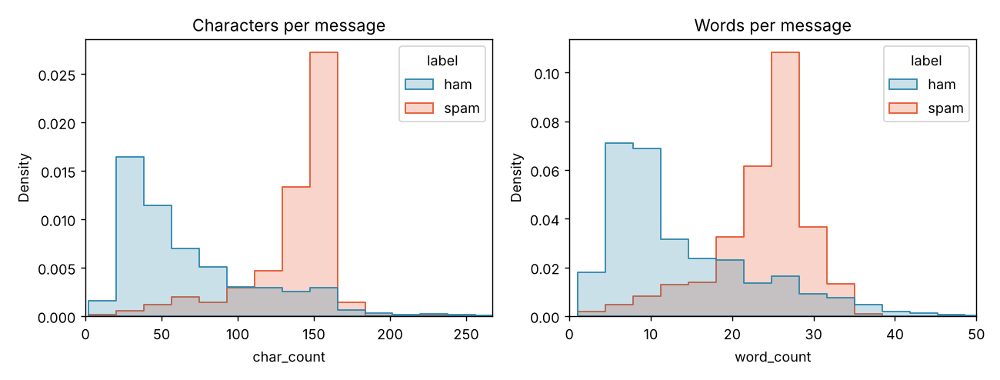
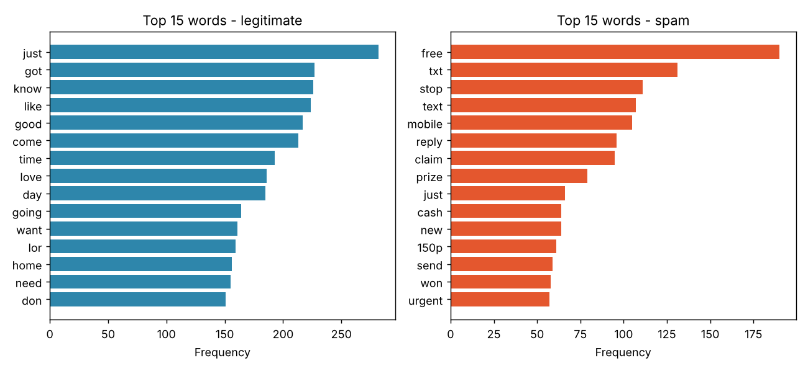
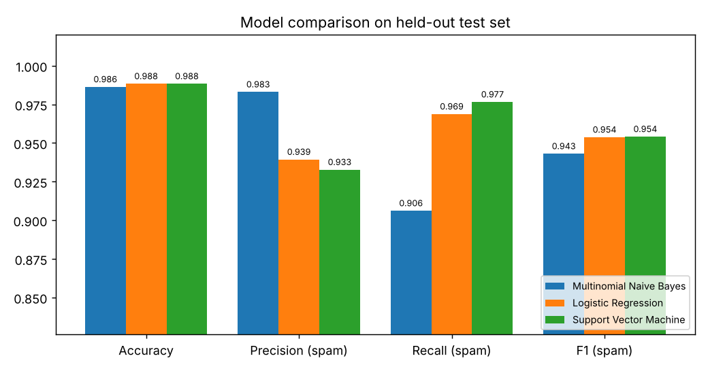
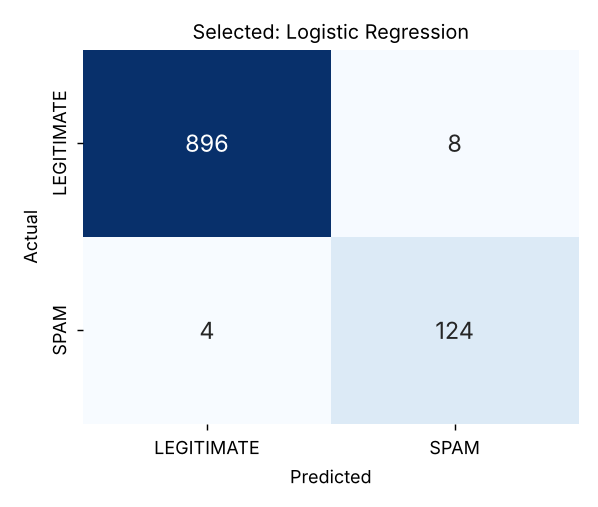
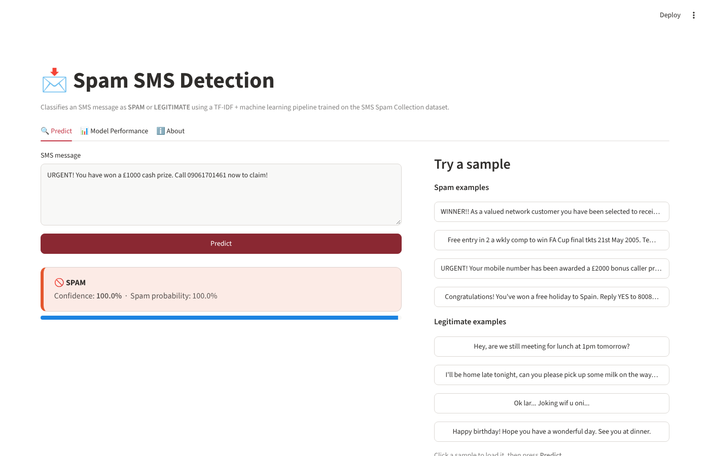
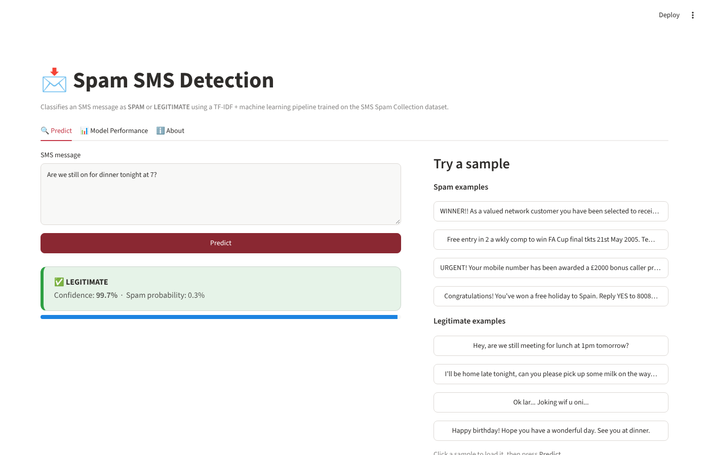
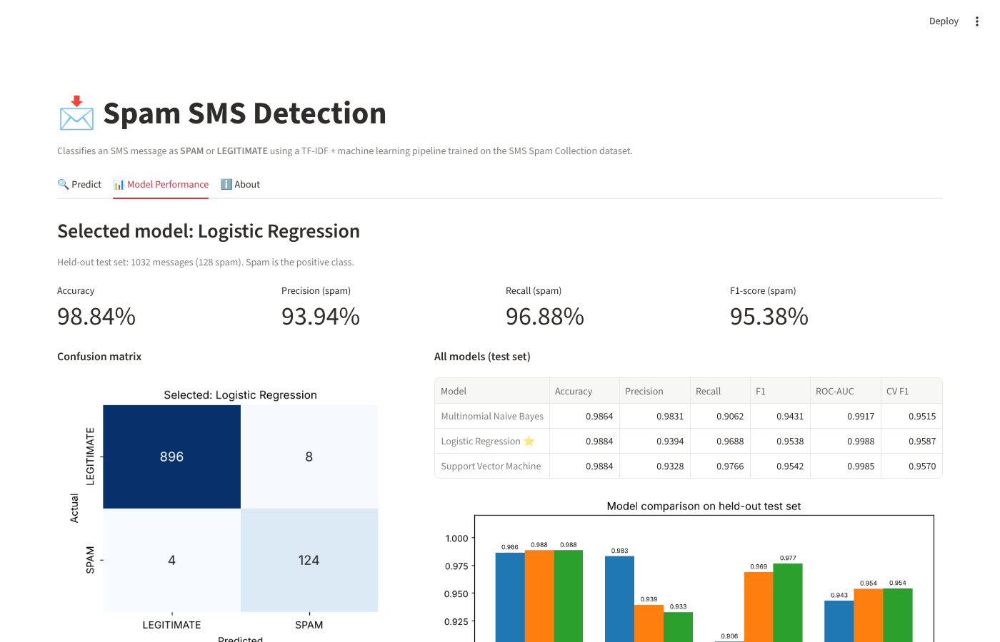

# 📩 Spam SMS Detection

**CodSoft Machine Learning Internship · Task 4**

A machine learning system that classifies SMS messages as **SPAM** or **LEGITIMATE**.
It covers the full workflow: data cleaning, exploratory analysis, TF-IDF feature
extraction, a comparison of three classifiers, model selection, automated tests and an
interactive Streamlit web app.

---

## 🎯 Objective

Build an AI/ML model that detects spam SMS messages using TF-IDF features with
**Multinomial Naive Bayes**, **Logistic Regression** and **Support Vector Machines**.
The goal is to compare them fairly and deploy the best one. The emphasis is on
**spam recall** (catching spam) while keeping false alarms on genuine messages low.

## 📊 Dataset

The data is the **SMS Spam Collection** dataset (`data/spam.csv`, extracted from the provided ZIP).

| Column | Meaning |
|---|---|
| `v1` | Category: `ham` (legitimate) or `spam` |
| `v2` | Raw SMS text |
| `Unnamed: 2..4` | CSV artefact: overflow text from 50 messages containing commas |

**Cleaning performed (actual numbers):**

| Step | Result |
|---|---|
| Raw rows | 5,572 (4,825 ham / 747 spam) |
| Overflow text in `Unnamed` columns | merged back into the message for 50 rows, then the columns were dropped |
| Missing values | 0 rows removed |
| Duplicate (label, message) rows | 414 removed* |
| **Clean dataset** | **5,158 messages: 4,516 ham (87.6%) / 642 spam (12.4%)** |
| Label encoding | `ham → 0 (LEGITIMATE)`, `spam → 1 (SPAM)` |

\*403 rows are exact duplicates in the raw file. A further 11 become duplicates once
leading and trailing whitespace is trimmed and overflow text is merged.

**Source & licence:** *SMS Spam Collection v.1* by Tiago A. Almeida and José María Gómez Hidalgo, distributed via the [UCI Machine Learning Repository](https://archive.ics.uci.edu/dataset/228/sms+spam+collection) under the [CC BY 4.0](https://creativecommons.org/licenses/by/4.0/) licence. The messages are real 2000s-era SMS, so spam texts include the phone numbers, short codes and URLs used by spammers; the data is used here only for research and education.

> Almeida, T.A., Gómez Hidalgo, J.M., Yamakami, A. *Contributions to the Study of SMS Spam Filtering: New Collection and Results.* Proceedings of the 2011 ACM Symposium on Document Engineering (DocEng'11), Mountain View, CA, USA, 2011.

**EDA highlights:** spam messages average **138 characters / 15.4 digits**, against **71
characters / 0.3 digits** for legitimate messages. Spam is dominated by words like
*free, txt, stop, text, mobile, reply, claim, prize, cash*.

<p>


</p>


## 🛠️ Technologies Used

- **Python 3.13**
- **scikit-learn**: TF-IDF, Naive Bayes, Logistic Regression, LinearSVC, GridSearchCV, Pipeline
- **pandas / NumPy**: data handling
- **matplotlib / seaborn**: visualisations
- **joblib**: model persistence
- **Streamlit**: web application
- **pytest**: automated testing
- **Jupyter**: exploratory notebook

## 🧠 Machine Learning Methodology

1. **Text cleaning** (`src/text_cleaning.py`): the text is lower-cased. URLs, e-mails,
   phone numbers and short codes (5+ digits), currency symbols and other numbers are
   replaced with placeholder tokens (`urltoken`, `phonetoken`, `currencytoken`,
   `numtoken`). Punctuation is stripped. Spam is recognised by the *presence* of
   these items, not their exact values.
2. **Stratified train/test split**: 80/20 (4,126 / 1,032 messages), which keeps the
   12.4% spam ratio in both sets.
3. **TF-IDF vectorisation**: word unigrams and bigrams with sublinear TF. The vectoriser
   is the first step of a scikit-learn `Pipeline`, so it is **fitted only on training
   data**. Inside cross-validation it is re-fitted on each training fold, so there is no
   data leakage.
4. **Models**:
   - Multinomial Naive Bayes
   - Logistic Regression (`class_weight="balanced"`)
   - Linear SVM (`LinearSVC`, `class_weight="balanced"`), wrapped in
     `CalibratedClassifierCV` to produce real probabilities for the app's confidence score
5. **Hyper-parameter tuning**: `GridSearchCV` with stratified 5-fold CV **on the training
   set only**, optimising spam F1.
6. **Model selection**: the model with the highest **cross-validated spam F1** is
   selected, so the test set is never used to choose a model. F1 is used rather than raw
   recall because a model that flags everything would have perfect recall but be useless.
7. **Final evaluation**: each tuned model is scored once on the held-out test set.
8. **Persistence**: the complete pipeline (cleaning → TF-IDF → classifier) is saved to
   `models/spam_classifier.joblib`.

## 📈 Model Evaluation Results

These are the real results from `python train.py` on the held-out test set of 1,032
messages (128 spam). SPAM is the positive class.

| Model | Accuracy | Precision (spam) | **Recall (spam)** | F1 (spam) | ROC-AUC | CV F1 (train) |
|---|---|---|---|---|---|---|
| Multinomial Naive Bayes | 0.9864 | **0.9831** | 0.9062 | 0.9431 | 0.9917 | 0.9515 |
| **Logistic Regression ⭐ selected** | **0.9884** | 0.9394 | 0.9688 | 0.9538 | **0.9988** | **0.9587** |
| Support Vector Machine | **0.9884** | 0.9328 | **0.9766** | **0.9542** | 0.9985 | 0.9570 |

**Confusion matrices (test set):**

| Model | TN | FP (ham → spam) | FN (spam missed) | TP |
|---|---|---|---|---|
| Naive Bayes | 902 | 2 | 12 | 116 |
| Logistic Regression | 896 | 8 | 4 | 124 |
| SVM | 895 | 9 | 3 | 125 |

**Interpretation**

- **Naive Bayes** is the most conservative model: it produces the fewest false alarms (2)
  but misses 12 of 128 spam messages (90.6% recall).
- **Logistic Regression** and **SVM** catch far more spam (96.9% and 97.7% recall),
  at the cost of a few more false alarms. On the test set the two are practically
  tied: they differ by a single message in each confusion-matrix cell.
- **Logistic Regression was selected** because it had the best cross-validated spam F1
  on the training data (0.9587 against 0.9570 for SVM). This choice was made before
  looking at the test set. It also has the highest ROC-AUC (0.9988) and gives native,
  well-behaved probabilities.
- Tuning mattered. An untuned Naive Bayes (`alpha=1.0`) reaches only about 0.66 spam
  recall, while the tuned `alpha=0.05` reaches 0.906.

The full report, with per-model classification reports and best hyper-parameters, is in
[`reports/evaluation_report.md`](reports/evaluation_report.md). Machine-readable results
are in `reports/metrics.json` and `reports/model_comparison.csv`.

<p>


</p>

## 📁 Project Structure

```
CODSOFT_TASK4/
├── app.py                      # Streamlit web application
├── train.py                    # End-to-end training / evaluation script
├── requirements.txt
├── README.md
├── .gitignore
├── data/
│   └── spam.csv                # SMS Spam Collection dataset
├── notebooks/
│   └── spam_sms_detection.ipynb   # EDA + modelling walkthrough (executed)
├── src/
│   ├── config.py               # Paths, seeds, label mapping
│   ├── data_preprocessing.py   # Loading & cleaning
│   ├── text_cleaning.py        # SMS text normalisation
│   ├── eda.py                  # EDA statistics & plots
│   ├── models.py               # TF-IDF pipelines + hyper-parameter grids
│   ├── evaluation.py           # Metrics & plots
│   └── predict.py              # Model loading, validation, prediction
├── models/
│   └── spam_classifier.joblib  # Trained pipeline (selected model)
├── reports/
│   ├── evaluation_report.md
│   ├── metrics.json
│   ├── model_comparison.csv
│   ├── classification_reports.txt
│   ├── figures/                # EDA plots, confusion matrices, comparison chart
│   └── screenshots/            # Streamlit app screenshots
└── tests/                      # pytest suite (40 tests)
```

## ⚙️ Installation

```bash
git clone https://github.com/shivrajsinghtech/CODSOFT_TASK4.git
```

```bash
cd CODSOFT_TASK4
```

Create and activate a virtual environment (recommended):

```bash
python -m venv .venv
```

```bash
source .venv/bin/activate
```

On Windows, activate it with `.venv\Scripts\activate` instead.

```bash
pip install -r requirements.txt
```

## ▶️ How to Execute

**1. Train the models** (optional, since a trained model is already included). This
regenerates the model, metrics and figures in about 20 seconds:

```bash
python train.py
```

**2. Launch the web app:**

```bash
streamlit run app.py
```

Then open http://localhost:8501 in your browser.

**3. Run the automated tests:**

```bash
python -m pytest -v
```

**4. Explore the notebook:**

```bash
jupyter notebook notebooks/spam_sms_detection.ipynb
```

**Use the model from Python:**

```python
from src.predict import predict_message
predict_message("WINNER! Claim your £900 prize now, call 09061701461")
# {'label': 'SPAM', 'is_spam': True, 'confidence': 0.99..., 'spam_probability': 0.99...}
```

## 🖥️ Streamlit Application

Features:

- SMS input box with a **Predict** button
- **SPAM / LEGITIMATE** result with **prediction confidence** and spam probability
- One-click **sample spam** and **sample legitimate** messages
- **Model Performance** tab with accuracy, precision, recall, F1, the confusion matrix
  and a comparison of all three models
- **About** tab with the methodology and EDA figures
- Input validation: empty input, symbols-only text and over-long messages show a
  friendly warning, and a model-loading or prediction error is reported without crashing

### Screenshots

| Spam prediction | Legitimate prediction |
|---|---|
|  |  |



**To capture your own screenshots:**

1. Run `streamlit run app.py` and open http://localhost:8501.
2. Click a sample message (or type one) and press **Predict**.
3. Take a screenshot (Windows: `Win + Shift + S`, macOS: `Cmd + Shift + 4`, Linux: `PrtSc`).
4. Open the **📊 Model Performance** tab and take another screenshot.
5. Save the images in `reports/screenshots/`. They are referenced above, so replacing
   the files updates the README.

## ✅ Testing

There are 40 automated tests in `tests/`, and all of them pass:

| File | Covers |
|---|---|
| `test_preprocessing.py` | Text cleaning, column removal, missing values, duplicates, label encoding, real-dataset integrity |
| `test_prediction.py` | Model loading, spam and legitimate predictions, empty, `None`, non-string, symbols-only, over-long and Unicode input |
| `test_training_pipeline.py` | Metric correctness, stratified split, TF-IDF fitted on training data only (leakage check), every model trains and evaluates, saved report consistency |
| `test_app.py` | Streamlit app startup, metrics display, empty-input warning, spam and legitimate predictions in the UI, sample buttons |

## ⚠️ Limitations

- The dataset is from the early 2010s and mostly UK-based. Modern spam styles (for
  example delivery or bank phishing links) may be under-represented.
- The test set contains only 128 spam messages, so a difference of one message moves
  recall by about 0.8 percentage points.

## 🔗 GitHub Repository

**https://github.com/shivrajsinghtech/CODSOFT_TASK4**

## 👥 Contributors

- [shivrajsinghtech](https://github.com/shivrajsinghtech)

Author: **Shivraj Singh** · B.Tech student · CodSoft Machine Learning Intern
