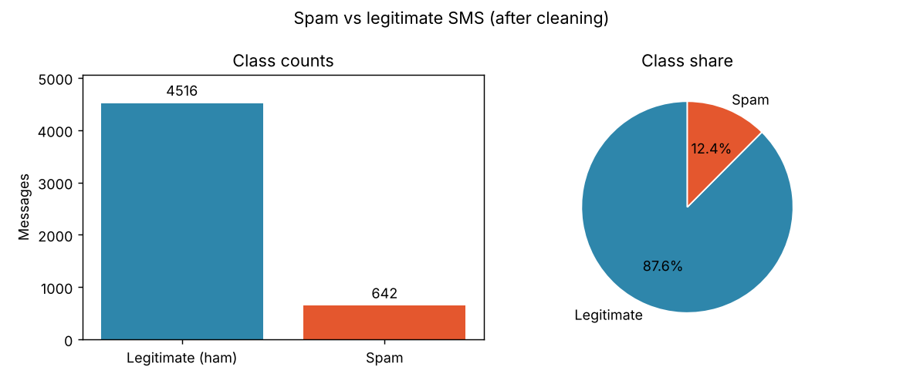
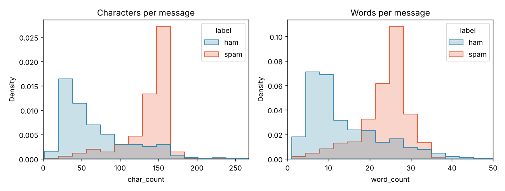
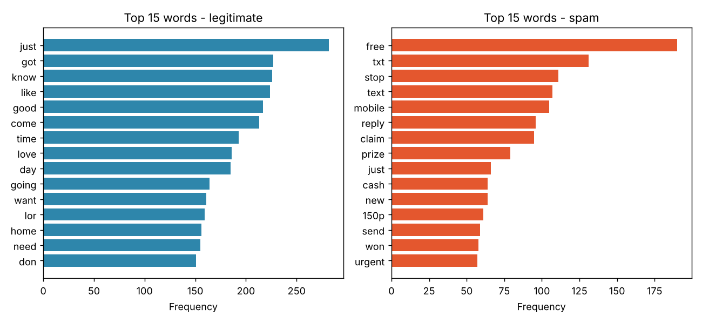
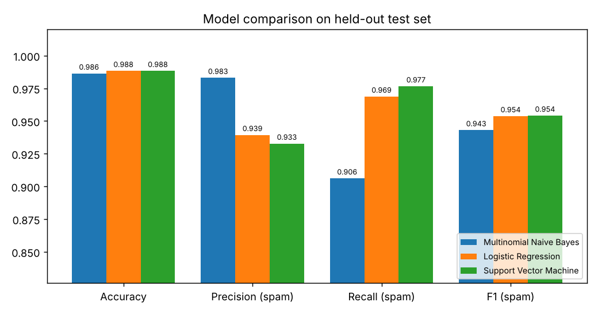
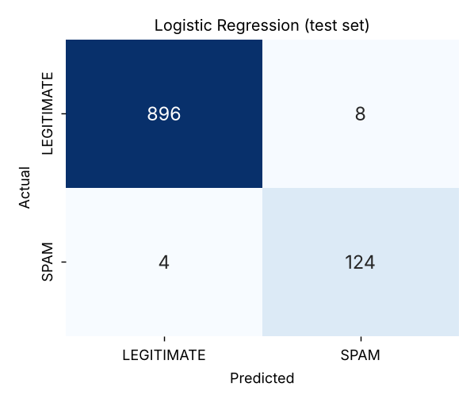
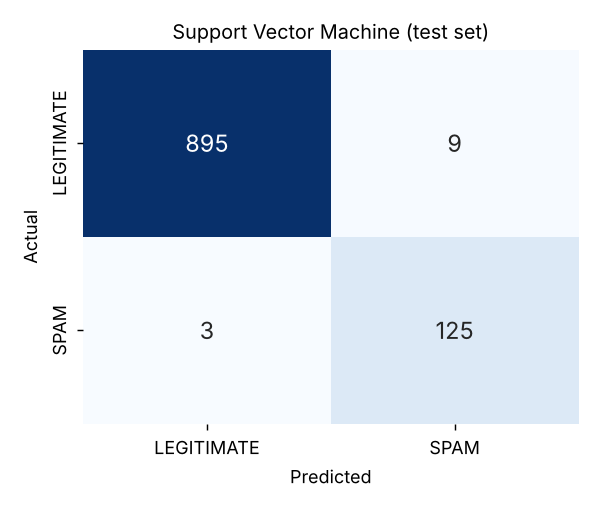

# Spam SMS Detection - Model Evaluation Report

_Generated by `train.py` on 2026-11-18 15:55 UTC_

## Dataset

- Raw rows: **5572**
- Rows whose message overflowed into unnamed columns (text merged back): **50**
- Dropped columns: Unnamed: 2, Unnamed: 3, Unnamed: 4
- Missing rows removed: **0**
- Duplicate rows removed: **414**
- Clean rows: **5158** (ham: 4516, spam: 642)
- Train / test (stratified): **4126 / 1032** (spam in test: 128)

### Average message statistics by class

| Class | Characters | Words | Digits | Upper-case ratio |
|---|---|---|---|---|
| ham | 71.02 | 14.24 | 0.3 | 0.08 |
| spam | 137.88 | 23.7 | 15.44 | 0.16 |

## Test-set results (SPAM = positive class)

| Model | Accuracy | Precision (spam) | Recall (spam) | F1 (spam) | ROC-AUC | CV F1 (train) |
|---|---|---|---|---|---|---|
| Multinomial Naive Bayes | 0.9864 | 0.9831 | 0.9062 | 0.9431 | 0.9917 | 0.9515 |
| Logistic Regression **(selected)** | 0.9884 | 0.9394 | 0.9688 | 0.9538 | 0.9988 | 0.9587 |
| Support Vector Machine | 0.9884 | 0.9328 | 0.9766 | 0.9542 | 0.9985 | 0.9570 |

## Confusion matrices (test set)

**Multinomial Naive Bayes** - TN=902, FP=2 (legitimate flagged as spam), FN=12 (spam missed), TP=116

**Logistic Regression** - TN=896, FP=8 (legitimate flagged as spam), FN=4 (spam missed), TP=124

**Support Vector Machine** - TN=895, FP=9 (legitimate flagged as spam), FN=3 (spam missed), TP=125

## Per-model classification reports

### Multinomial Naive Bayes

Best hyper-parameters: `{'clf__alpha': 0.05, 'tfidf__min_df': 2}`

```
              precision    recall  f1-score   support

  LEGITIMATE     0.9869    0.9978    0.9923       904
        SPAM     0.9831    0.9062    0.9431       128

    accuracy                         0.9864      1032
   macro avg     0.9850    0.9520    0.9677      1032
weighted avg     0.9864    0.9864    0.9862      1032
```

### Logistic Regression

Best hyper-parameters: `{'clf__C': 100.0, 'tfidf__min_df': 1}`

```
              precision    recall  f1-score   support

  LEGITIMATE     0.9956    0.9912    0.9933       904
        SPAM     0.9394    0.9688    0.9538       128

    accuracy                         0.9884      1032
   macro avg     0.9675    0.9800    0.9736      1032
weighted avg     0.9886    0.9884    0.9884      1032
```

### Support Vector Machine

Best hyper-parameters: `{'clf__estimator__C': 10.0, 'tfidf__min_df': 1}`

```
              precision    recall  f1-score   support

  LEGITIMATE     0.9967    0.9900    0.9933       904
        SPAM     0.9328    0.9766    0.9542       128

    accuracy                         0.9884      1032
   macro avg     0.9647    0.9833    0.9738      1032
weighted avg     0.9887    0.9884    0.9885      1032
```

## Model selection

Selected model: **Logistic Regression**.

Selection used the mean spam F1-score from stratified 5-fold cross-validation on the training set, so the test set was never used to choose a model. F1 was preferred over raw recall because a model that flags every message would have perfect spam recall but be useless; F1 rewards catching spam while keeping legitimate messages out of the spam folder.

## Figures








